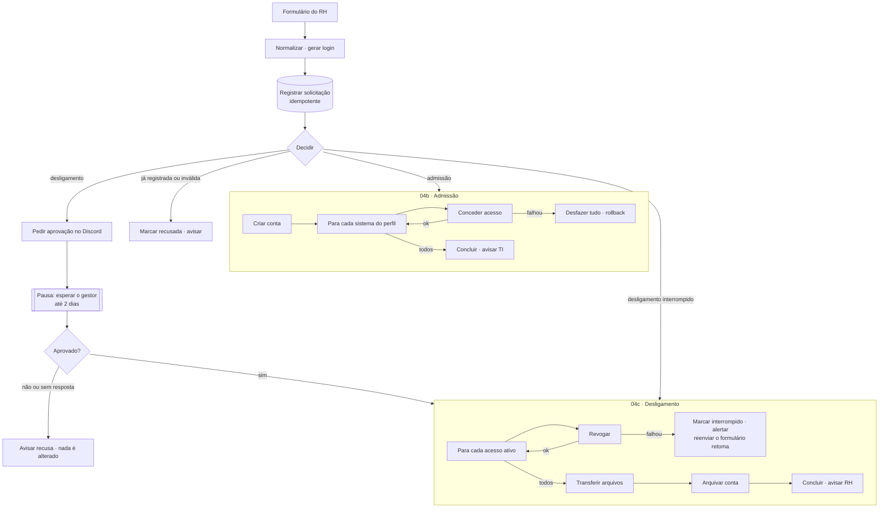

# 04 — Onboarding e offboarding de colaborador

**Status:** 🚧 Em construção
**Integrações:** formulário do n8n · PostgreSQL (diretório e sistemas simulados) · Discord
**Competências demonstradas:** sub-workflows, aprovação humana no meio do fluxo
(*human-in-the-loop*), rollback por compensação (padrão *saga*), retomada de processo
interrompido, idempotência, matriz de acesso fora do código

## O problema

A entrada de um colaborador envolve criar conta, e-mail, acessos a sistemas, preparar
equipamento e enviar as informações do primeiro dia — tudo manual, disparado por mensagem
avulsa, e com etapas que se perdem. A saída é pior: acesso revogado com atraso é risco de
segurança real, e frequentemente alguém descobre meses depois que uma conta continuava
ativa.

E quando o processo é feito à mão e para no meio (o sistema X estava fora do ar, a pessoa
saiu de férias), ninguém sabe exatamente o que já foi feito e o que falta.

## A solução

Um formulário dispara o processo completo. Admissão roda direto; desligamento só roda depois
de o gestor aprovar por um link. Cada etapa fica registrada, então uma falha no meio nunca
deixa o processo em estado desconhecido.



## Ponto de atenção — o diretório é simulado

Num ambiente real, as contas estariam no Google Workspace ou no Entra ID e os acessos em cada
sistema. Os dois exigem conta paga ou de administrador corporativo; para manter o portfólio
com **custo zero**, o diretório e os sistemas são simulados em tabelas do Postgres
(`dir_*`), e cada chamada de "API" é uma função SQL que conclui a ação ou falha com erro —
inclusive quando o sistema está marcado como indisponível, que é como os testes de falha
foram feitos.

O que este workflow demonstra é a orquestração em volta: aprovação, rollback, retomada,
idempotência e log. Trocar a simulação pela API real é trocar o nó que chama a função.

## Os nós, em ordem

### 04a · Solicitação (16 nós)

| # | Nó | Tipo | O que faz |
|---|----|------|-----------|
| 1 | Formulário do RH | Form Trigger | Tipo, nome, perfil, gestor, data efetiva. |
| 2 | Normalizar solicitação | Code | Gera o login ("Ana Lúcia Souza" → `ana.souza`, sem acento) e valida. |
| 3 | Registrar solicitação | Postgres | Insere com chave única (tipo, login, data). Reenvio do mesmo formulário devolve a solicitação existente. |
| 4 | Decidir próximo passo | Code | admitir · pedir aprovação · retomar desligamento · descartar (com motivo). |
| 5 | Qual caminho? | Switch | Um caminho por decisão. |
| 6 | Executar admissão | Execute Workflow | Chama o 04b. |
| 7 | Marcar aguardando aprovação → Pedir aprovação ao gestor | Postgres + Discord | Manda o link de aprovação. |
| 8 | Aguardar decisão do gestor | Wait (formulário) | **Pausa a execução** até o gestor responder (máximo 2 dias). |
| 9 | Registrar decisão → Aprovado? | Postgres + IF | Grava quem decidiu, quando e por quê — antes de qualquer ação destrutiva. |
| 10 | Executar desligamento / Avisar recusa | Execute Workflow / Discord | |
| 11 | Retomar desligamento | Execute Workflow | Desligamento interrompido continua **sem nova aprovação** (já foi aprovado). |
| 12 | Registrar descarte → Avisar | Postgres + Discord | Pedido inválido fica como recusado, com o motivo. |

### 04b · Admissão (sub-workflow, 10 nós)

Criar conta → listar os sistemas do perfil na **matriz de acesso** → laço "um sistema por
vez" → conceder acesso. Sucesso volta ao laço; erro vai para **Desfazer admissão**, que
revoga tudo o que já tinha sido concedido e arquiva a conta. No fim, aviso para a TI
preparar o equipamento do perfil.

### 04c · Desligamento (sub-workflow, 12 nós)

Listar acessos ativos → laço → revogar. Erro → marca como **interrompido** e alerta (sem
desfazer). No fim: transferir arquivos para o gestor, arquivar a conta, avisar o RH.

## Decisões técnicas

- **Por que a admissão desfaz tudo e o desligamento não:** são as duas formas de recuperar
  um processo que falhou no meio.
  - *Admissão — rollback (backward recovery).* Meio-cadastro é pior que nenhum: a pessoa
    entraria com acessos pela metade e ninguém saberia. Se um sistema falha, os acessos já
    concedidos são revogados, um por um — APIs de sistemas diferentes não têm transação
    entre si, então a reversão é feita por **ações contrárias** (padrão *saga*). Cada
    reversão fica registrada.
  - *Desligamento — retomada (forward recovery).* Devolver acesso a quem está saindo seria
    o pior resultado possível. O processo para, alerta e é retomado depois, do ponto onde
    parou.
- **Por que cada etapa é registrada antes de seguir:** é o que permite a retomada. Antes de
  executar uma etapa, o fluxo pergunta ao banco se ela já foi concluída nesta solicitação e,
  se foi, pula. O registro só acontece se a ação deu certo (o resultado da ação é argumento
  do registro), então uma etapa que falhou nunca aparece como feita.
- **Por que a matriz de acesso fica no banco, e não no workflow:** mudar "quem recebe o quê"
  é mudar linhas de uma tabela, sem tocar no n8n.
- **Por que sub-workflows:** admissão e desligamento são processos diferentes, testáveis
  isoladamente, e o desligamento pode ser chamado de dois lugares (depois da aprovação e na
  retomada) sem duplicar nós.
- **Por que `motivo` e `erro` são colunas separadas:** os testes mostraram que um campo só
  fazia a mensagem de falha técnica apagar o motivo da decisão do gestor — exatamente a
  informação que uma auditoria vai pedir.
- **Por que o link de aprovação é seguro:** o n8n assina a URL de retomada; um endereço
  montado à mão, sem a assinatura, é recusado (HTTP 401). Ninguém aprova um desligamento
  adivinhando o link.

## O que não funcionou

A tabela completa está no [CHECKLIST](CHECKLIST.md). Os que mais ensinaram:

- **O item de erro não sabe de onde veio.** Na saída de erro de um nó, o item traz só a
  mensagem — o sistema que falhou se perde. A primeira versão do rollback gravou o motivo
  vazio. A correção foi buscar o item de origem pelo vínculo entre itens do n8n
  (`$('Um sistema por vez').item`), e não pelo primeiro item do laço.
- **Um campo, dois significados.** O motivo do gestor era sobrescrito pela mensagem de falha
  (ver *Decisões técnicas*).

## Tratamento de erro

| Situação | O que acontece |
|---|---|
| Mesmo formulário enviado duas vezes | Uma solicitação só; o reenvio é descartado com o motivo. |
| Sistema fora do ar na admissão | Rollback: tudo o que foi concedido é revogado; status `falhou_revertida`. Reenviar o formulário recomeça. |
| Sistema fora do ar no desligamento | Status `interrompida` e alerta; o que já foi revogado continua revogado. Reenviar o formulário retoma sem nova aprovação. |
| Gestor recusa ou não responde em 2 dias | Nenhum acesso é alterado; status `recusada` com o motivo. |
| Desligamento de quem não tem conta | Descartado como `recusada`, com o motivo. |

## Pré-requisitos

1. Tabelas e funções:
   ```bash
   docker cp workflows/04-onboarding-offboarding/sql/001-onboarding-offboarding.sql n8n-postgres:/tmp/001-onboarding-offboarding.sql
   docker exec n8n-postgres psql -U n8n -d n8n -f /tmp/001-onboarding-offboarding.sql
   ```
2. Importar os três workflows. No 04a, apontar os três nós *Execute Workflow* para os IDs do
   04b e do 04c (no export estão como `COLE_AQUI_O_ID_DO_WORKFLOW_...`).
3. Credenciais: Postgres e Discord Webhook (as mesmas do workflow 02).
4. Publicar os três (o n8n 2 chama a versão publicada dos sub-workflows).

## Como testar

Formulário: `http://localhost:5678/form/rh-colaborador`. Para simular um sistema fora do ar:

```sql
UPDATE portfolio.dir_sistemas SET disponivel = false WHERE codigo = 'vpn';  -- e true para voltar
```

| Cenário | Esperado |
|---|---|
| Admissão, perfil Administrativo | Conta + CRM, e-mail, ERP e VPN; aviso para a TI |
| Mesmo formulário de novo | Nada novo |
| Admissão com a VPN fora do ar | CRM, e-mail e ERP concedidos e **desfeitos**; reenviar com a VPN de volta conclui |
| Desligamento, gestor aprova pelo link do Discord | Tudo revogado, arquivos transferidos, conta arquivada |
| Desligamento, gestor recusa | Nada muda |
| Desligamento com o ERP fora do ar | Interrompido no ERP; reenviar retoma sem nova aprovação |

## Resultado

*A preencher com os prints.* Todos os cenários acima testados ponta a ponta, incluindo a
regressão depois das correções: zero execuções com erro — as falhas simuladas seguem pelos
caminhos de erro desenhados (rollback e interrupção), em vez de derrubar o workflow.

## Próximos passos

- [ ] Trocar o diretório simulado pela API real (Google Workspace Admin SDK ou Microsoft
      Graph).
- [ ] Abrir automaticamente o chamado de equipamento no fluxo de triagem (workflow 01).
- [ ] Error Workflow global.
