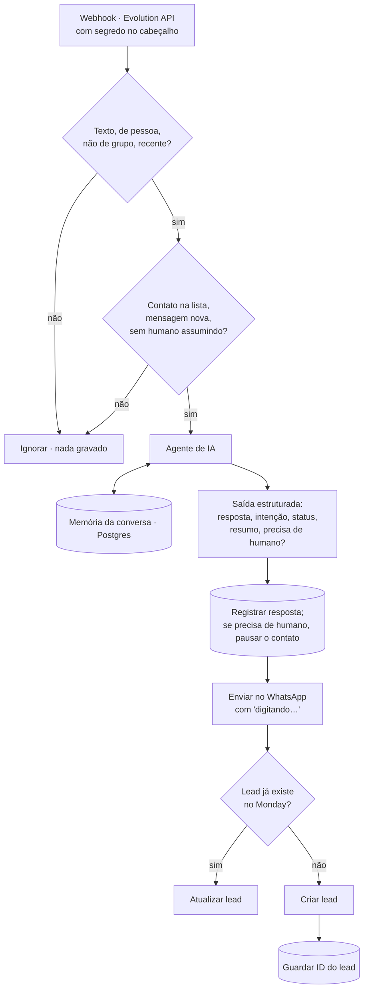
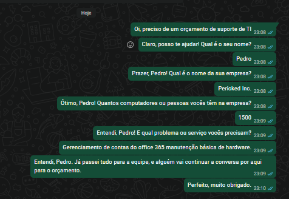
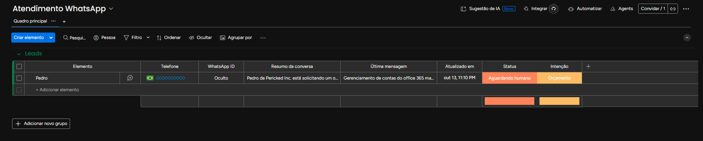
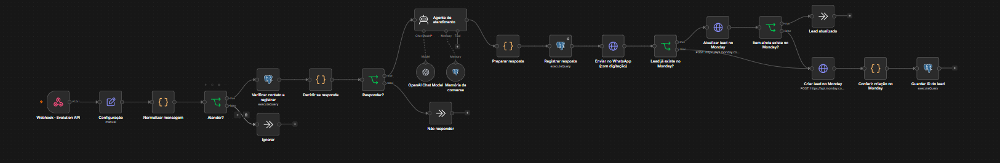

# 05 — Atendimento humanizado no WhatsApp com CRM

**Status:** ✅ Concluído
**Integrações:** WhatsApp (via Evolution API, self-hosted) · OpenAI · Monday.com · PostgreSQL
**Competências demonstradas:** webhook de canal externo, agente de IA com memória de
conversa e *tool calling*, integração com CRM via API, design de automação com limite
de risco explícito

## O problema

Atendimento inicial por WhatsApp — responder dúvidas simples, entender o que a pessoa
precisa, registrar o contato como lead — hoje é feito por uma pessoa lendo e digitando
cada mensagem, ou nem é feito, e o lead se perde na conversa. Não existe um lugar central
com o histórico de quem entrou em contato, o que perguntou e em que ponto a conversa
parou.

Este workflow é um estudo para uma entrevista: mostra um agente de IA respondendo pelo
WhatsApp com memória de conversa, decidindo quando resolver sozinho e quando chamar um
humano, e mantendo um CRM (Monday.com) atualizado sozinho.

## A solução

Um agente de IA recebe a mensagem, consulta e atualiza o lead no Monday.com como
ferramentas próprias (*tool calling*), responde pelo WhatsApp com uma pausa de digitação
simulada, e só passa para um humano quando decide que não deve responder sozinho.



## Ponto de atenção — leia antes de configurar

**Evolution API não é o WhatsApp oficial.** É um gateway open-source, self-hosted, que
fala o protocolo do WhatsApp Web (via a biblioteca Baileys). Funciona bem e de graça, mas
está fora dos Termos de Uso do WhatsApp — o número conectado corre risco real de
restrição, principalmente com volume alto ou comportamento que pareça automação agressiva
(mensagens não solicitadas, respostas instantâneas demais, envio em massa).

Este workflow foi desenhado para reduzir esse risco, e não só para funcionar:

- **É só reativo.** Nunca inicia conversa — só responde quem manda mensagem primeiro.
- **Ignora grupos.** Só atende conversa individual.
- **Simula digitação antes de responder**, numa pausa proporcional ao tamanho da
  resposta — também é o que torna o atendimento "humanizado" de verdade, não só uma
  frase de efeito.
- **Tem uma saída para humano.** O agente não é obrigado a resolver tudo sozinho; ver
  *Decisões técnicas*.

Ainda assim, é risco real, não risco zero. Por decisão do autor, o número conectado é o
pessoal — ver a decisão sobre isso abaixo.

## Os nós, em ordem

| # | Nó | Tipo | O que faz |
|---|----|------|-----------|
| 1 | Webhook · Evolution API | Webhook | Recebe cada mensagem. Exige o cabeçalho `x-webhook-secret`; sem ele, 403. |
| 2 | Configuração | Edit Fields (Set) | URL da Evolution, instância, board do Monday, modo de teste e idade máxima da mensagem. |
| 3 | Normalizar mensagem | Code | Descarta grupo, status, mídia, mensagem antiga (sincronização de histórico) e o que o próprio número enviou. Sempre diz o motivo. |
| 4 | Atender? | IF | Segue só o que passou no filtro. |
| 5 | Verificar contato e registrar | Postgres | Uma consulta: confere a lista, grava a mensagem com trava de idempotência, lê a passagem para humano. Sempre devolve uma linha. |
| 6 | Decidir se responde | Code | Fora da lista, repetida ou com humano assumindo: não responde. |
| 7 | Responder? | IF | — |
| 8 | Agente de atendimento | AI Agent | gpt-4o-mini, modo JSON, temperatura 0,2, com memória da conversa por número (Postgres). |
| 9 | Preparar resposta | Code | Valida a saída da IA (valor fora da lista vira padrão seguro; JSON ilegível vira passagem para humano), calcula a pausa de digitação e monta as colunas do Monday. |
| 10 | Registrar resposta | Postgres | Grava resposta e intenção; se precisar de humano, pausa o contato. |
| 11 | Enviar no WhatsApp (com digitação) | HTTP Request | `sendText` da Evolution com `delay`: mostra "digitando…" e só então envia. |
| 12 | Lead já existe no Monday? | IF | Pelo ID guardado no contato. |
| 13 | Atualizar lead no Monday | HTTP Request | GraphQL `change_multiple_column_values`. |
| 14 | Item ainda existe no Monday? | IF | O GraphQL responde erro com HTTP 200; se a atualização foi recusada (item excluído), recria. |
| 15 | Criar lead no Monday | HTTP Request | GraphQL `create_item`. |
| 16 | Conferir criação no Monday | Code | Transforma erro escondido no corpo em erro de verdade. |
| 17 | Guardar ID do lead | Postgres | Salva o ID do item no contato. |

## Decisões técnicas

- **Por que Evolution API, e não a API oficial do WhatsApp (Meta Cloud API):** a API
  oficial tem uma camada gratuita real (conversas de serviço dentro de uma cota mensal),
  mas exige conta de desenvolvedor Meta, aprovação de app e, para produção, verificação
  de negócio — fricção alta para um projeto de estudo com prazo curto. A Evolution API
  sobe em minutos, no mesmo Docker Compose que já existe neste repositório.

- **Por que o número conectado é o pessoal do autor, e não um número reserva:** decisão
  explícita, sabendo do risco de restrição do WhatsApp — não havia um número separado
  disponível no momento. Mitigado com as quatro proteções listadas acima em *Ponto de
  atenção*: sem iniciar conversa, sem grupo, com pausa de digitação, e teto de decisão
  onde o agente para e chama um humano.

- **Por que Monday.com como CRM, e não uma tabela no Postgres:** o Postgres já guarda o
  histórico técnico (idempotência, auditoria). O CRM precisa ser o lugar onde uma pessoa
  — não um desenvolvedor — acompanha os leads sem abrir um banco de dados. Board criado
  por script (`scripts/monday-board.mjs`), no mesmo espírito do
  `workflows/01-triagem-chamados/scripts/notion-database.mjs`: colunas com ID fixo,
  conferíveis, sem depender de digitar oito nomes certos na interface.

- **Por que memória de conversa em vez de reprocessar o histórico a cada mensagem:** sem
  memória, o agente trataria cada mensagem como uma conversa nova — perderia contexto de
  "aquilo que você falou há dois minutos". A memória é indexada pelo número de WhatsApp
  (`wa_id`), então cada contato tem a própria linha do tempo.

- **Por que a IA decide o quê, e nós fixos decidem o como, no Monday:** o plano inicial era
  dar ao agente ferramentas para gravar no CRM (*tool calling*). Mudou antes de construir:
  as colunas do Monday exigem JSON em formatos específicos por tipo (telefone, data,
  status), e um erro de formato do modelo viraria lead gravado errado sem aviso. O agente
  devolve intenção, status, resumo e resposta numa saída estruturada; nós fixos montam o
  JSON e gravam. É o mesmo princípio do workflow 01: a IA classifica, mas não executa sozinha.

- **Por que uma lista de contatos que podem ser atendidos:** o número conectado é pessoal.
  Sem lista, a IA responderia família e amigos. Só números em
  `portfolio.atendimento_contatos` são atendidos — e a mensagem de quem não está lá não é
  gravada em lugar nenhum.

- **Por que nada do WhatsApp fica guardado fora da tabela do workflow:** a Evolution recebe
  *todas* as mensagens do número conectado. Na configuração padrão, ela guardou 114 mil
  mensagens e 2.861 contatos no primeiro pareamento, imprimiu o conteúdo das mensagens no log
  do container, e o n8n guardava cada mensagem recebida no histórico de execuções. Os três
  foram desligados (armazenamento da Evolution, log do container e salvamento de execuções do
  workflow) e o que existia foi apagado. Para diagnosticar um erro, o salvamento é ligado
  por alguns minutos e desligado de novo.

- **Por que o webhook tem um segredo no cabeçalho:** a URL do webhook é a porta de entrada do
  atendimento. Sem o cabeçalho `x-webhook-secret`, o n8n responde 403 — ninguém de fora
  consegue simular uma mensagem e fazer a IA responder em nome do número.

## O que não funcionou

A tabela completa, com sintoma e solução de cada item, está no [CHECKLIST](CHECKLIST.md). Os
três que mais ensinaram:

- **"Não guardar nada" não era o padrão de nenhuma peça.** Ao parear o WhatsApp, a Evolution
  sincronizou e guardou 114 mil mensagens e 2.861 contatos; o container imprimia o texto de
  cada mensagem no log; e o n8n, mesmo configurado para não salvar execuções, só *marcava*
  as execuções para apagar num ciclo posterior — lido no código-fonte do n8n e provado com 45
  execuções "presas" com o corpo das mensagens. Foram quatro ajustes até o banco ficar com
  zero execuções depois de chamadas reais.
- **O parser estruturado recusava respostas certas.** O agente alternava entre devolver texto
  e "chamar uma ferramenta" de formato, e às vezes o invólucro vinha vazio; outras vezes, um
  status no campo de intenção. A validação saiu da IA e foi para um nó Code.
- **Erro com cara de sucesso, de novo.** Um lead excluído pela interface do Monday fez o
  workflow parar de atualizar o CRM com a execução verde: o GraphQL responde erro com HTTP 200.
  É a terceira vez no portfólio (workflow 01: `output` vazio; workflow 02: `RETURNING *`)
  que a falha mais perigosa é a que não aparece.

## Tratamento de erro

| Falha | O que acontece |
|---|---|
| Webhook chamado sem o segredo | 403; nada é processado. |
| Mensagem de grupo, mídia, antiga ou de número fora da lista | Ignorada sem gravar nada. |
| Webhook reentregue (mesma mensagem duas vezes) | A chave única em `wa_message_id` barra a segunda; não há segunda resposta. |
| IA devolve JSON ilegível ou campo fora da lista | Campo inválido vira valor seguro; JSON ilegível vira passagem para humano com mensagem padrão — o cliente nunca fica sem resposta. |
| Lead excluído no Monday | O workflow recria o lead e guarda o ID novo. |
| Monday recusa a criação | O nó *Conferir criação no Monday* para a execução com erro explícito. A resposta ao cliente já foi enviada antes. |
| Mensagem chega durante uma republicação do workflow | Perdida (`Active version not found`). Janela de segundos; limite conhecido. |

## Pré-requisitos

### 1. Subir a Evolution API

Já está no `infra/docker-compose.yml`. Gere a chave e suba o serviço:

```bash
openssl rand -hex 24
```

Cole o resultado em `EVOLUTION_API_KEY` no `.env`, depois:

```bash
docker compose -f infra/docker-compose.yml --env-file .env up -d evolution
```

### 2. Tabela de log

```bash
docker cp workflows/05-atendimento-whatsapp-crm/sql/001-atendimento-mensagens.sql n8n-postgres:/tmp/001-atendimento-mensagens.sql
docker exec n8n-postgres psql -U n8n -d n8n -f /tmp/001-atendimento-mensagens.sql
```

### 3. Board no Monday.com

```bash
node workflows/05-atendimento-whatsapp-crm/scripts/monday-board.mjs
node workflows/05-atendimento-whatsapp-crm/scripts/monday-board.mjs --conferir
```

### 4. Credenciais no n8n

OpenAI e Postgres (os mesmos dos workflows anteriores), **Monday.com account** (token do
`.env`), **Evolution API** (Header Auth, `apikey`) e **Webhook Evolution** (Header Auth,
`x-webhook-secret`). As três novas podem ser criadas pela CLI do n8n
(`n8n import:credentials`), lendo os segredos do `.env` — sem copiar e colar.

### 5. Lista de atendimento e webhook

```bash
docker cp workflows/05-atendimento-whatsapp-crm/sql/002-atendimento-contatos.sql n8n-postgres:/tmp/002-atendimento-contatos.sql
docker exec n8n-postgres psql -U n8n -d n8n -f /tmp/002-atendimento-contatos.sql
```

Depois, `POST /webhook/set/{instância}` na Evolution apontando para
`http://n8n:5678/webhook/atendimento-whatsapp`, só com o evento `MESSAGES_UPSERT` e o
cabeçalho `x-webhook-secret`.

## Como testar

Com um número só (o conectado), ligue `modo_teste_conversa_propria` no nó *Configuração* e
coloque o próprio número na lista. A conversa **"Você"** do WhatsApp vira o canal de teste: só
mensagens digitadas no celular contam — a resposta da IA sai com origem "web", e é essa
diferença que impede a IA de responder a si mesma. Nessa conversa o "digitando…" não aparece.

1. **Qualificação:** "preciso de um orçamento de suporte de TI" → a IA pergunta nome, empresa,
   tamanho e necessidade, uma coisa por vez, e só então passa para humano.
2. **Silêncio depois da passagem:** a mensagem seguinte é registrada e não recebe resposta.
3. **Monday:** o lead aparece no grupo *Leads* e é atualizado a cada mensagem.
4. **Lead excluído:** exclua o item no Monday e mande outra mensagem (depois de liberar o
   contato) → o lead é recriado.
5. **Fora do escopo:** "vocês fazem site?" → recusa gentil, sem chamar humano.

Para iterar no prompt sem mandar nada para o WhatsApp, as conversas foram simuladas direto no
webhook com um número fictício na lista: o envio falha de propósito, mas a resposta da IA fica
registrada antes do envio.

## Resultado







- Atendimento completo de ponta a ponta: pergunta, qualificação em quatro passos, passagem
  para humano e silêncio depois dela; lead criado, atualizado e recriado no Monday.
- **Zero execuções guardadas** no n8n depois de dezenas de mensagens reais e simuladas, e
  nenhuma mensagem pessoal guardada na Evolution — só as conversas de números da lista, na
  tabela do próprio workflow.
- Prompt validado em quatro cenários simulados (roteiro passo a passo, tudo de uma vez, falta
  só o nome, fora do escopo).

## Próximos passos

- [ ] Liberar o contato de volta para a IA pelo próprio Monday (hoje é um `UPDATE` no banco).
- [ ] Error Workflow global, como nos workflows 01 e 02.
- [ ] Considerar um número de WhatsApp dedicado, separado do pessoal, se o projeto
      crescer além do estudo para entrevista.
- [ ] Migrar para a API oficial da Meta se este atendimento algum dia for para produção
      de verdade — a Evolution API é para estudo e demonstração, não para depender dela
      num negócio real.
