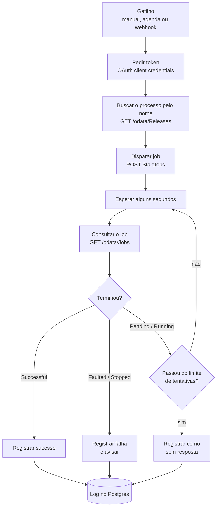

# 07 — Ponte n8n ↔ UiPath Orchestrator

**Status:** 🔜 Planejado
**Tempo de construção:** —
**Integrações:** n8n · API REST do UiPath Orchestrator (OAuth 2.0, External Application) ·
PostgreSQL
**Competências demonstradas:** OAuth 2.0 *client credentials*, API OData, disparo e
acompanhamento de job por polling, integração entre automação moderna e RPA clássico

## O problema

Robôs de RPA costumam viver isolados: rodam por agendamento no Orchestrator e ninguém fora do
time de RPA sabe quando terminaram ou se falharam. Quando um evento de outro sistema deveria
disparar o robô — chegou a planilha de fornecedores, um formulário foi preenchido, um
chamado foi aprovado — alguém precisa entrar no Orchestrator e clicar em *Start Job*, e
depois voltar para ver o resultado.

Empresas que já usam n8n (ou outra ferramenta de integração) para o resto da operação ficam
com duas ilhas de automação que não conversam.

## A solução

Um workflow n8n que autentica na API do Orchestrator, dispara o processo do workflow 06,
acompanha o job até ele terminar e registra o resultado no Postgres, como os outros
workflows do portfólio.



## Os nós, em ordem

*A preencher durante a construção. O script [`scripts/orchestrator_api.py`](scripts/orchestrator_api.py)
é a referência para cada nó HTTP Request: mesma URL, mesmos cabeçalhos, mesmo corpo.*

## Decisões técnicas

- **Por que External Application com *client credentials*:** é o único jeito de autenticar
  sem um usuário logado — o n8n é um sistema, não uma pessoa. O token vale por tempo
  limitado e é pedido de novo a cada execução.
- **Por que buscar o processo pelo nome, e não fixar a `ReleaseKey`:** a chave muda quando o
  processo é republicado em outra pasta; o nome é estável.
- **Por que polling, e não esperar um aviso do Orchestrator:** o Orchestrator tem webhooks,
  mas eles precisariam alcançar o n8n por uma URL pública, e o n8n deste portfólio roda em
  `localhost`. Polling com limite de tentativas funciona sem expor nada.

## Tratamento de erro

*A preencher. Já previsto: token recusado (credencial ou scope errado), processo não
encontrado na pasta, job que não termina dentro do limite, job com falha.*

## Como testar

1. Rode o script de referência primeiro, para validar credenciais e pasta:
   ```bash
   python workflows/07-ponte-n8n-uipath/scripts/orchestrator_api.py --listar
   ```
2. *A preencher com os passos do workflow n8n.*

## Resultado

*A preencher.*

## Próximos passos

- [ ] Trocar o polling por webhook do Orchestrator quando o n8n estiver numa URL pública.
- [ ] Passar argumentos de entrada para o job (`InputArguments`).
